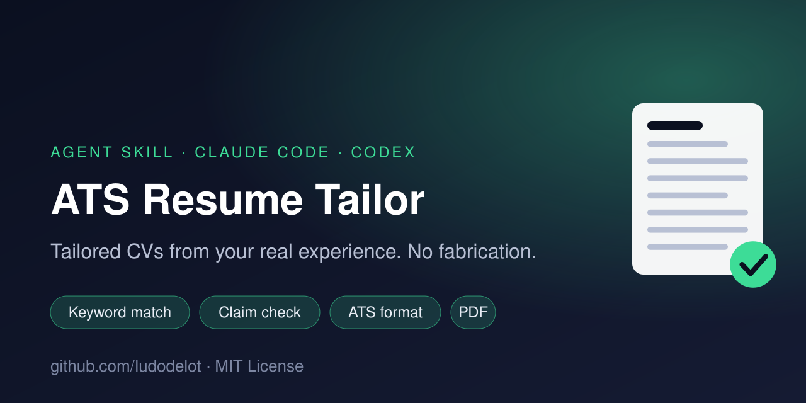
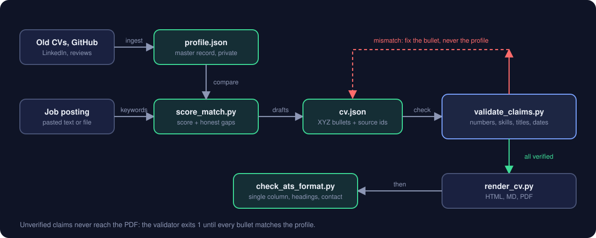
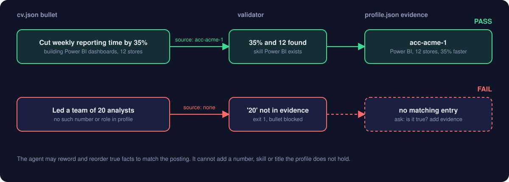

<div align="center">



# ATS Resume Tailor

**Generate ATS-friendly CVs and resumes tailored to each job posting, from your real career profile. Every claim verified. No fabrication, no keyword tricks.**

[](LICENSE)
[](SKILL.md)
[](scripts)
[](scripts)
[](https://github.com/ludodelot/ats-resume-tailor/actions)
[](#privacy)
[](#how-it-works)

[Install](#install) · [How it works](#how-it-works) · [Quick start](#quick-start) · [Scripts](#scripts) · [FAQ](#faq)

</div>

---

Generic CVs miss keywords. Generic AI CVs invent things. **ATS Resume Tailor** is an [Agent Skill](https://docs.claude.com) for Claude Code, Codex and Cursor that keeps one private **master career profile** of everything you have really done. For each job it selects, rewrites and scores only what is true, and refuses to add what is not.

## Features

- **Living career profile.** Grows from old CVs (PDF/DOCX), GitHub repos, LinkedIn export and performance reviews.
- **Job analysis.** Extracts required vs preferred keywords from a job description.
- **Transparent match score.** A documented rubric with matched terms and honest gaps, before and after tailoring.
- **Claim verification.** Every bullet points to an accomplishment id. Numbers, skills, titles, companies and dates are checked against your profile. Any mismatch fails the build.
- **ATS-safe output.** Single column, standard headings, real text. HTML, Markdown and PDF.
- **Format checker.** Flags missing contact info, non-standard headings, multi-column layouts, decorative glyphs and page count.
- **Region presets.** US/UK, EU, DACH and LatAm conventions for photo and personal data.
- **Word and JSON Resume export.** A dependency-free `.docx` writer and a JSON Resume converter.
- **Skills taxonomy.** Aliases (JS = JavaScript, K8s = Kubernetes, PostgreSQL under SQL) so synonyms count as matches. Extend `references/skills_taxonomy.json`.
- **Profile merge.** New CVs or repos add evidence without duplicating it, and conflicts are flagged, never overwritten.
- **Application log.** Which evidence went into which application.

## How it works



The gate is the point. Each bullet cites an accomplishment id, and the validator compares numbers, skills, titles, companies and dates with your profile:



## Install

Claude Code (personal skill):

```bash
git clone https://github.com/ludodelot/ats-resume-tailor ~/.claude/skills/ats-resume-tailor
```

Other agents: copy the folder to your agent's skills location, or reference `SKILL.md` from `AGENTS.md`.

## Quick start

With your agent: *"Use ats-resume-tailor. Build my profile from `~/old_cv.pdf` and my GitHub `<user>`, then tailor a CV for this job: `<paste the posting>`."*

Try the scripts on the bundled fake data:

```bash
python3 scripts/extract_keywords.py examples/job.example.txt --profile examples/profile.example.json > /tmp/kw.json
python3 scripts/score_match.py /tmp/kw.json examples/profile.example.json --cv examples/cv.example.json
python3 scripts/validate_claims.py examples/cv.example.json examples/profile.example.json
python3 scripts/render_cv.py examples/cv.example.json --out /tmp/cv --region us
python3 scripts/check_ats_format.py /tmp/cv/cv.pdf
```

## The honesty guarantee

| The skill will | The skill will never |
|---|---|
| Reword true experience with the job's own terminology | Invent skills, tools, numbers, titles or employers |
| Reorder and select your most relevant evidence | Hide white text or stuff keywords |
| Report gaps and ask if you really have the skill | Add a requirement just because the posting lists it |
| Trace every bullet to a profile source | Send your profile anywhere |

## Scripts

Python 3, standard library. Optional tools in the last column.

| Script | Purpose | Optional |
|---|---|---|
| [`ingest_sources.py`](scripts/ingest_sources.py) | PDF, DOCX, GitHub, LinkedIn to readable sources | `pdftotext` or `pypdf`, `python-docx` |
| [`extract_keywords.py`](scripts/extract_keywords.py) | Required and preferred keywords from a posting | |
| [`score_match.py`](scripts/score_match.py) | Transparent match score and gaps | |
| [`validate_claims.py`](scripts/validate_claims.py) | Verify every bullet against the profile | |
| [`render_cv.py`](scripts/render_cv.py) | HTML, Markdown, PDF | `weasyprint` or Chrome |
| [`export_docx.py`](scripts/export_docx.py) | ATS-safe Word file, no dependencies | |
| [`export_jsonresume.py`](scripts/export_jsonresume.py) | Convert to the JSON Resume schema | |
| [`merge_profile.py`](scripts/merge_profile.py) | Merge new evidence without duplicates, flag conflicts | |
| [`log_application.py`](scripts/log_application.py) | Log each application and the evidence it used | |
| [`check_ats_format.py`](scripts/check_ats_format.py) | Heuristic ATS parseability check | `pdftotext` or `pypdf` |

## Repository layout

```
SKILL.md        agent instructions (the skill)
scripts/        deterministic steps
references/     ATS facts vs myths, schemas, scoring, bullet writing, region rules
examples/       fake profile, job posting and CV
evals/          test cases
tests/          unit tests (stdlib unittest)
assets/         banner and social preview
```

## Privacy

`profile/`, `jobs/` and `out/` are git-ignored. Nothing leaves your machine, except the GitHub username you choose to ingest, which is sent to the public GitHub API. Job postings and PDFs are treated as data, never as instructions.

## FAQ

**Does it guarantee I pass an ATS?** No tool can. Real ATS scoring is proprietary. The match score is a proxy, and [`references/ats-facts.md`](references/ats-facts.md) separates evidence from myth.

**PDF or DOCX?** Both parse fine when they contain real text, and the skill exports both. Avoid scanned images, columns, tables, text boxes and header/footer contact info.

**Can it write cover letters?** No. This skill is focused on CVs.

**What if the job needs a skill I don't have?** It reports the gap and asks whether you actually have it. It does not add it on its own.

**Which regions are supported?** Presets for US/UK, EU, DACH and LatAm, documented in [`references/region-rules.md`](references/region-rules.md). Confirm local norms for your target country.

## Related topics

ATS resume optimizer, tailored CV generator, AI resume builder, applicant tracking system, job description keyword extraction, resume keyword matching, JSON Resume, resume parser check, Claude Code skills, career profile.

## Contributing

Issues and pull requests are welcome: new region presets, ESCO/O*NET skill mapping, a DOCX renderer, more parser tests.

## License

[MIT](LICENSE) © Ludovic Delot
